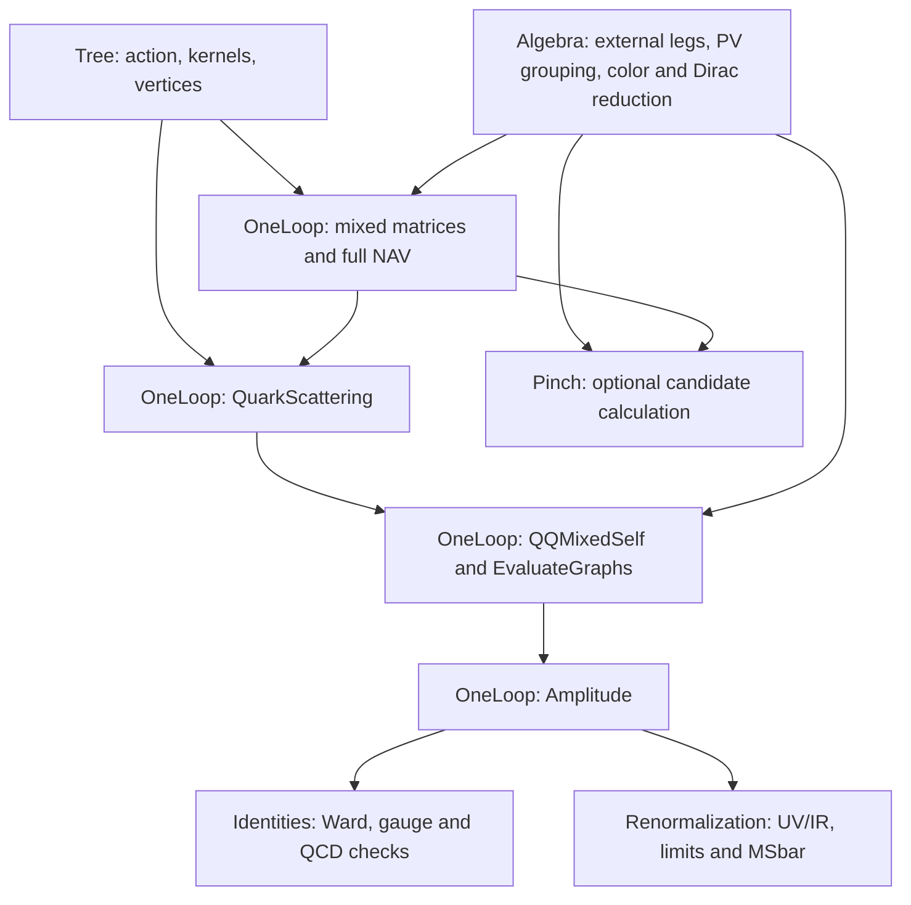

# The calculation

The main object is the one-loop amplitude for massless, distinct-flavour quark scattering. Read the source in the following physical order; the order in which Wolfram loads definitions is only an implementation detail.

```text
Models/: action
    |
Tree/: quadratic kernel, propagators and vertices
    |
OneLoop/: mixed self energy + AV + NAV + boxes + external residues
    |
Algebra/: D-dimensional color-spin structures and scalar integrals
    |
Renormalization/: UV/IR separation, mass limits and MSbar
```

`Identities/` tests these calculations through Ward/BRST identities, gauge differences and QCD limits. It is not an extra term in the amplitude.

## Where to read

| Physical question | Start here |
| --- | --- |
| What is summed in the amplitude? | [OneLoop/Amplitude.wl](OneLoop/Amplitude.wl) |
| What is the tree propagator matrix? | [Tree/Propagators.wl](Tree/Propagators.wl), [Tree/QuadraticAction.wl](Tree/QuadraticAction.wl) |
| What are the interaction vertices? | [Tree/VertexRules.wl](Tree/VertexRules.wl); the action is in [Models](../Models/RGZ_W2.6.fr) |
| How is the full mixed self energy calculated? | [OneLoop/MixedSelfEnergy.wl](OneLoop/MixedSelfEnergy.wl) |
| How is the scattering task prepared? | [OneLoop/QuarkScattering.wl](OneLoop/QuarkScattering.wl) |
| How does the mixed matrix enter scattering? | [OneLoop/QQMixedSelf.wl](OneLoop/QQMixedSelf.wl), [Algebra/MixedProjection.wl](Algebra/MixedProjection.wl) |
| Where is the quark on-shell residue? | [OneLoop/QuarkSelfEnergy.wl](OneLoop/QuarkSelfEnergy.wl) |
| Where are spectral simplification and M0 restoration? | [Algebra/SpectralCoordinates.wl](Algebra/SpectralCoordinates.wl), [Renormalization/MassRestoration.wl](Renormalization/MassRestoration.wl) |
| Where are the AVs and boxes generated? | [OneLoop/QuarkGraphs.wl](OneLoop/QuarkGraphs.wl) |
| Where is the complete non-Abelian vertex? | [OneLoop/NonAbelianVertex.wl](OneLoop/NonAbelianVertex.wl) |
| How are graphs reduced to masters? | [OneLoop/EvaluateGraphs.wl](OneLoop/EvaluateGraphs.wl), [Algebra/TensorIntegrals.wl](Algebra/TensorIntegrals.wl) |
| What are the integral and coefficient identities? | [Algebra/PassarinoVeltman.wl](Algebra/PassarinoVeltman.wl), [Algebra/Coefficients.wl](Algebra/Coefficients.wl) |
| How is the regulator limit assembled? | [Renormalization/MassLimit.wl](Renormalization/MassLimit.wl) |
| How are the QCD contributions checked? | [Identities/QCDParts.wl](Identities/QCDParts.wl), [Identities/QCDBenchmark.wl](Identities/QCDBenchmark.wl) |
| Where are poles subtracted? | [Renormalization/UVIR.wl](Renormalization/UVIR.wl), [Renormalization/MSbar.wl](Renormalization/MSbar.wl) |
| How is gauge dependence tested? | [Identities/GaugeDependence.wl](Identities/GaugeDependence.wl) |

## Dependencies and the independent QQ route



An arrow means "provides input or tools to". `Internal/` supplies configuration, storage, continuation and display to these calculations. There is no arrow from `Pinch/` to the conventional QQ route.

The normal sequence is tree/model preparation, mixed matrices, `RGZQQStart`, `RGZQQPrepareSelf`, six `RGZQQRunPart` calls, then `RGZQQAmplitude`. `RGZNAVSum` supplies the full conventional vertex; it does not extract pinch pieces. `QuarkSelfEnergy.wl` contains the quark residue, while `QQMixedSelf.wl` connects the mixed-field insertion to the scattering currents.

`loadQuarkEngine[]` loads the mixed loop engine, shared external-leg/PV tools, quark graphs, residue and mass-limit formulas. `loadPTEngine[]` uses those shared tools and separately loads candidate kernels, their continuation and NAV pinch decomposition. A file's header states its role, input and prerequisites. The ordinary package load defines public commands; lazy engine files are listed explicitly in these loaders. `Identities/QCDBenchmark.wl` is an explicitly invoked calculation driver, rather than a definitions-only module.

`Algebra/GaugeCoefficients.wl` and `CommonDenominator.wl` implement coefficient algorithms. `Identities/` retains the physical checks that use them. `Pinch/` owns candidate initialization, staged evaluation and assembly. Read [the four API groups](../Documentation/API.md) after following the main calculation.

## The amplitude convention

The stored graph expressions are in the $i\mathcal M$ convention:

$$i\mathcal M^{(1)}=i\mathcal M_{\rm self}+i\mathcal M_{\rm AV_1}+i\mathcal M_{\rm AV_2}+i\mathcal M_{\rm NAV_1}+i\mathcal M_{\rm NAV_2}+i\mathcal M_{\rm Box_1}+i\mathcal M_{\rm Box_2}+2\Sigma_V(0)i\mathcal M^{(0)}.$$

The mixed insertion is $D^{(0)}_{Ai}\Pi_{ij}D^{(0)}_{jA}$. It includes all mixed fields; it is not obtained by keeping only $\Pi_{AA}$. No additional pinch term is added to the conventional amplitude. Keep $D$ until Laurent products are assembled.

The raw mixed-self source is multiplied by `1/(2 Pi)^4` once in `Amplitude.wl`. Reduced vertex/box parts already include this conversion. `SigmaV` already contains `g_s^2 CF/(16 Pi^2)`. See [the detailed conventions](../Documentation/Calculation.md).

## Files outside the derivation

- `Internal/` contains sessions, progress, cache reuse and continuation of the current calculation. It is not a physics-reading prerequisite.
- `RGZWorkflow.wl` declares public commands and loads definitions; `init.m` is the standard Wolfram entry point.

The model companions and notebook calculation sequence are unchanged. The current source is restricted to the zero-temperature scattering workflow; unrelated thermal, standalone vacuum and developer-registry interfaces have been archived locally. Historical `Work/` results are retained. Source reorganization changes calculation fingerprints, so restart the kernel before using it. This layout does not resolve the [remaining physical and mathematical checks](../Documentation/OpenChecks.md).

For the local mixed-self-energy flow, function inventory and load sequence, see [MixedSelfEnergyStructure](../Documentation/MixedSelfEnergyStructure.md).

For ordinary versus fixed-denominator gauge-coefficient reduction, see [GaugeCoefficientStructure](../Documentation/GaugeCoefficientStructure.md).

For a complete small calculation with actual intermediate expressions, start with [the quark-bubble walkthrough](../Documentation/QuarkBubbleWalkthrough.md).
